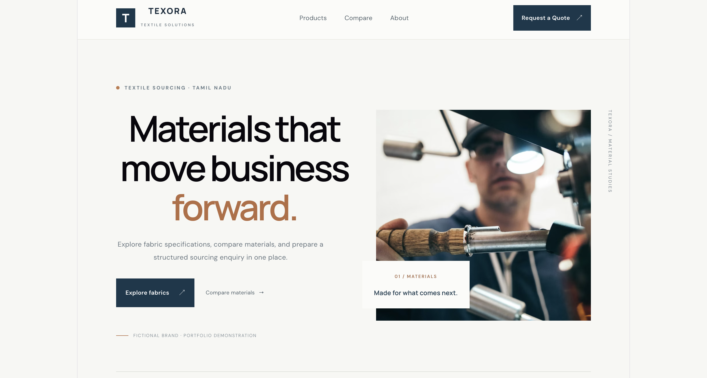
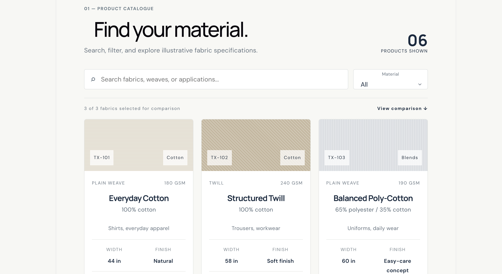
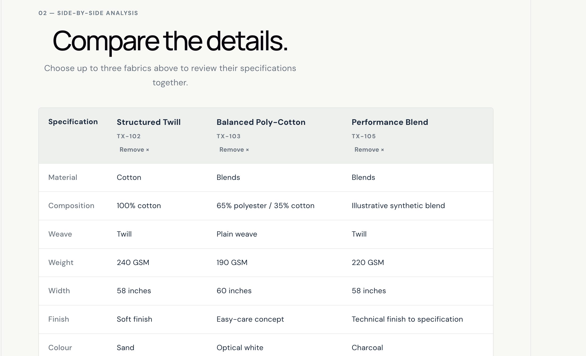
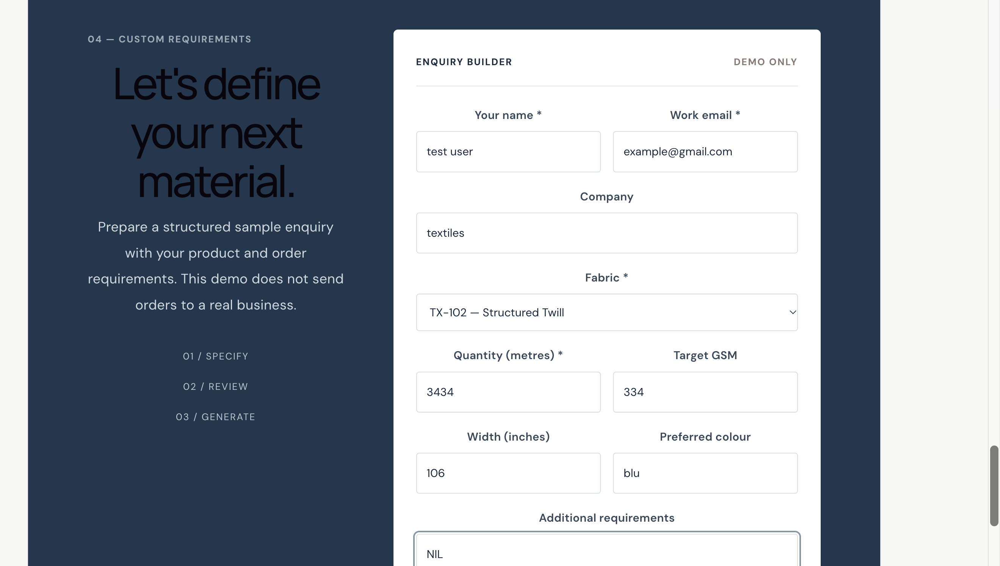

# Texora Textile Solutions

A responsive B2B textile catalogue website concept designed to help textile buyers explore fabrics, compare specifications, and prepare quotation enquiries.

## Project Preview

<!-- Add your actual website screenshots to docs/screenshots/ -->



## Features

- **Responsive interface** — layouts adapted for desktop and mobile screens.
- **Fabric catalogue** — browse six illustrative fabric products.
- **Search and filtering** — find fabrics using the available search and material filters.
- **Fabric comparison** — select and compare up to three fabrics.
- **Quotation enquiry form** — enter enquiry details and generate a formatted enquiry summary.
- **Copy to clipboard** — copy the generated enquiry summary for convenient sharing.
- **Industrial visual design** — a clean, professional interface designed for a B2B textile context.

## Screenshots

### Homepage


### Fabric Catalogue


### Fabric Comparison


### Quotation Enquiry


## Technology Stack

- React
- Vite
- JavaScript
- CSS

## Run Locally

Prerequisites: Node.js and npm.

1. Clone this repository.
2. Open the project directory in your terminal.
3. Install dependencies:

   ```bash
   npm install
   ```

4. Start the development server:

   ```bash
   npm run dev
   ```

5. Open the local URL shown in your terminal.

## Current Scope and Limitations

This is a frontend demonstration. The fabric information is illustrative and should not be treated as verified manufacturer specifications.

The quotation form generates an enquiry summary in the browser. It does not currently submit enquiries to a server or persist them in a database.

## Project Goals

This project explores how a clear product catalogue, comparison tools, and a structured enquiry flow can improve the experience of browsing textile products online.

## Future Improvements

- Backend integration for submitting and storing enquiries
- Product data management
- Validation and error handling
- Automated testing and deployment

---

**Status:** Frontend demonstration
